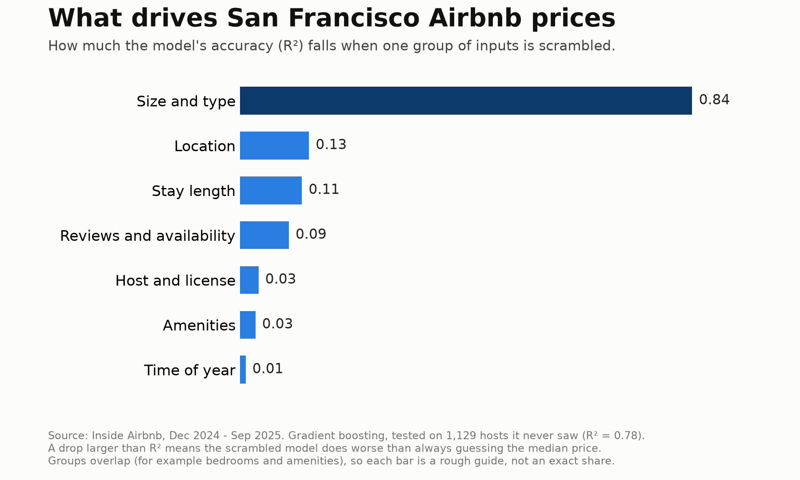
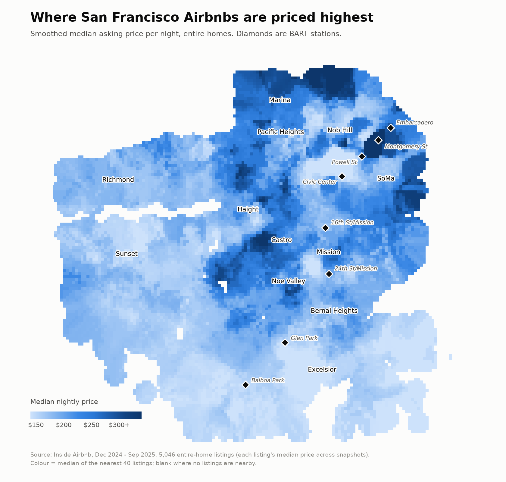

# Predicting San Francisco Airbnb Prices

This project predicts the nightly price of San Francisco Airbnb listings and identifies what drives it. It is a rebuild of a class project, with a focus on evaluating the model honestly and avoiding the data leakage that inflates many price-prediction scores.

**Result:** on hosts the model has never seen, gradient boosting predicts the nightly price with a typical error of **19% (about $29)** and an **R² of 0.78**. Always predicting the median price is 45% off (about $70). A lookup table of similar listings is 28% off (about $41).



## Key Findings

- **Size and type of the place drive the price.** Guests, bedrooms, bathrooms and entire home vs private room matter far more than anything else. Scrambling them drops the R² by 0.84, more than the whole score.
- **Location comes next** (0.13), followed by minimum stay (0.11) and reviews and availability (0.09). Host, amenities and time of year matter little (0.03, 0.03 and 0.01).
- **Distances to BART, Muni and tourist attractions add nothing.** The coordinates already carry the same information. Dropping all three distances changes the R² by -0.001.
- **Prices were about 10% higher in Jun and Sep 2025 than in Dec 2024.** One year of data cannot separate a seasonal pattern from a general rise in asking prices, so this is not reported as seasonality.
- **The model pulls predictions toward the middle.** It is 20% too high for listings under $100 and 19% too low for listings over $350.
- **It works as a price check.** The real price falls between two thirds and one and a half times the prediction for 83% of test listings. Only 3% are priced more than twice their prediction, which makes them worth a second look.



## Model Comparison

Results on the held-out test hosts.

| Model | R² | Typical error | Within 20% of the real price |
|---|---|---|---|
| Always the median price | 0.00 | 45% | 25% |
| Lookup table (median of similar listings) | 0.52 | 28% | 36% |
| Decision tree | 0.64 | 24% | 43% |
| Linear regression (ridge) | 0.71 | 22% | 47% |
| Random forest | 0.76 | 20% | 49% |
| **Gradient boosting** | **0.78** | **19%** | **52%** |

Across five different host splits, gradient boosting averages an R² of 0.77 (range 0.70 to 0.82) and the random forest 0.75. The choice of test hosts moves the R² by about 0.06, so the two models are treated as close.

## Methodology

The class notebook is the starting point. The question is the same, but the pipeline was rebuilt:

- **Split by host, not by row.** A listing appears in up to four snapshots, and one host often has several near-identical listings. A random split puts a listing in training and its twin in the test set, so the model has already seen the answer. The same random forest scores **0.91** with a random split and **0.76** with a split by host. The gap is leakage, not skill.
- **Training data only for tuning and filling blanks.** Missing values are filled with medians learned from the training rows, inside the model pipeline.
- **Data cleaning.** About 23% of rows were carried over from an earlier scrape and have no price. These were removed, along with hotel-style units, impossible values, duplicates and 48 rows with placeholder prices (more than 10 times or less than a tenth of the typical price of similar listings).
- **Meaningful baselines.** Beating "always predict the median" proves little. The lookup table is a much harder bar.
- **Validation of claims.** The model was retrained without the distance features, and without reviews and availability (which may partly reflect how well the price has worked). Those columns account for at most 0.035 of the R².

## Data

- **Listings:** [Inside Airbnb](https://insideairbnb.com/get-the-data/), San Francisco, four snapshots (Dec 2024, Mar 2025, Jun 2025, Sep 2025). About 31,000 raw rows, reduced to 7,026 listings from 3,762 hosts after cleaning.
- **Places:** BART stations, SFMTA Muni stops and a hand-compiled list of 60 attractions, used for the distance features.

File sources, checksums, and the reasons some files in `data/` are not used (the 2026 files measure price differently, and Dec 2025 has no prices) are documented in [`data/DATA_README.md`](data/DATA_README.md).

## Notebook Structure

[`san_francisco_airbnb_v2.ipynb`](san_francisco_airbnb_v2.ipynb) is saved with all outputs, so it can be read on GitHub without running anything.

| Section | Content |
|---|---|
| 0. Data and audit | Rows per snapshot, missing prices, extreme prices |
| 1. Spatial features | Distances to BART, Muni and attractions |
| 2. Season | Price differences between snapshots |
| 3. Cleaning | Stale rows, duplicates, impossible values |
| 4. Room and property type | Which listings are in scope |
| 5. Feature engineering | Host, amenities, neighbourhoods, bathrooms |
| 6. Price and outliers | Placeholder prices and the prediction target |
| 7. Missing values | A fill plan for each column |
| 8. Evaluation design and models | Host split, six predictors, stability |
| 9. Results and drivers | Feature importance, error analysis, price check |

## Getting Started

```bash
python -m venv .venv
source .venv/bin/activate
pip install pandas numpy scikit-learn matplotlib seaborn scipy jupyter
jupyter nbconvert --to notebook --execute --inplace san_francisco_airbnb_v2.ipynb
```

## Limitations

- Prices are **asking prices**, not what guests paid.
- The data covers **one city, one year and four dates**. The score says nothing about a new city or a new season.
- The model is built for homes and rooms in homes, **not hotels**.
- Feature effects describe what the model uses, **not what causes prices**. For example, why minimum stay matters as much as it does was not tested.

## Future Work

- Add more years of data to separate seasonality from the general price trend.
- Test the model on other cities.
- Search a wider range of model settings.
- Predict a price range instead of a single number.
